# Shelfkeeper

**A self-hosted library for the whole household: every book you own, on paper, as an ebook or as an audiobook, in one catalog, with each person's own reading life on top.**

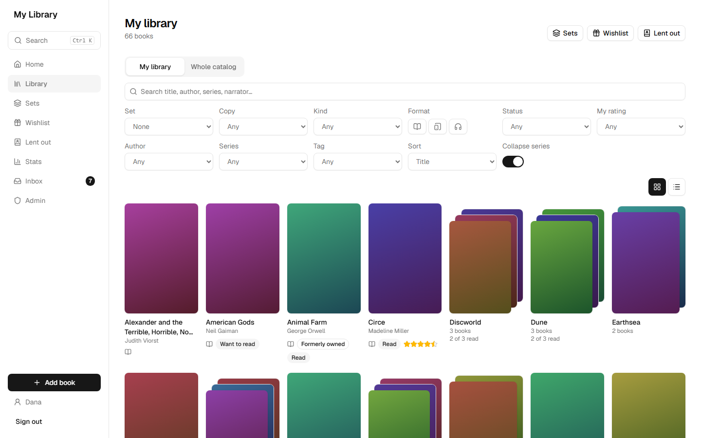

Paper books on the shelves, ebooks in Calibre, audiobooks in Audiobookshelf, a reading log in a spreadsheet, and nobody remembers who borrowed what. Shelfkeeper puts all of it in one place, on a server in your home, for everyone in the house.

A personal project, built for one household and shared as is: free to use, change and share under the [MIT license](#license). No support, and no promise of updates.

## What it does

- **One catalog, every format.** A book is one entry with its physical, ebook and audiobook editions, series (with gaps spotted), multi-volume sets, and titles in more than one language (Hebrew and English side by side).
- **Everyone gets their own library.** Each person builds a library from sets, keeps their own statuses, ratings and notes, and sees only what's shared with them. Kids sign in with a PIN.
- **A daily check-in.** "Still reading this one?" on Home: finished, still going, abandoned, or snooze. Optionally note the page, the audiobook time or the ebook %.
- **Stats and goals.** Books, hours and words per year and month, compared with last year, split by format, with goals that tell you when you're behind pace.
- **What next?** Picks your next book from your own shelves: the next one in a series you're in, something light, or a surprise, in the format you're in the mood for.
- **Books come in by themselves.** Syncs from Audiobookshelf, Calibre, Readarr and Chaptarr, imports a CSV reading log, and reads a photo of a shelf or a phone scan of an ISBN barcode. New books land in a review Inbox; nothing is added behind your back.
- **The household's paperwork.** Loans (who has what, since when), wishlists everyone can read (gift ideas), a household activity feed, and Ctrl K search that understands abbreviations (`twok` finds *The Way of Kings*).
- **Built to keep your data.** Verified nightly backups, a backup before every upgrade and restore, restore from the browser, and an optional encrypted copy in the cloud.
- **Works on the phone.** A phone layout with bottom tabs, installable as an app (PWA), light and dark.

## A look around

| | |
|---|---|
| 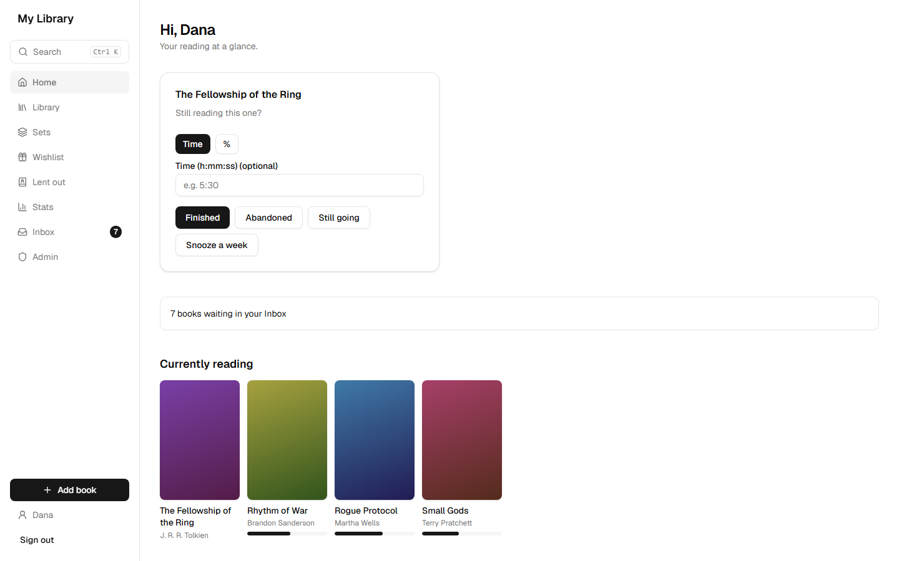 | 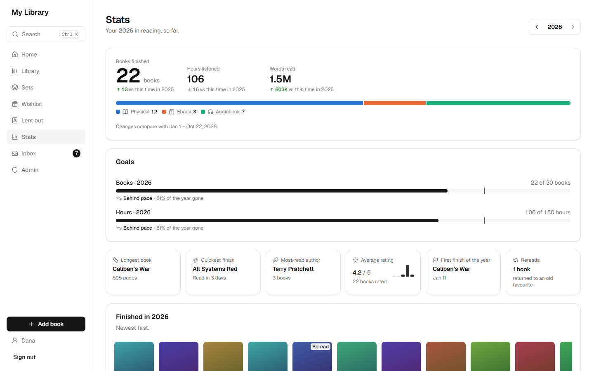 |
| **Home.** The daily check-in and what you're reading now. | **Stats.** Your year in reading, by format, against your goals. |
| 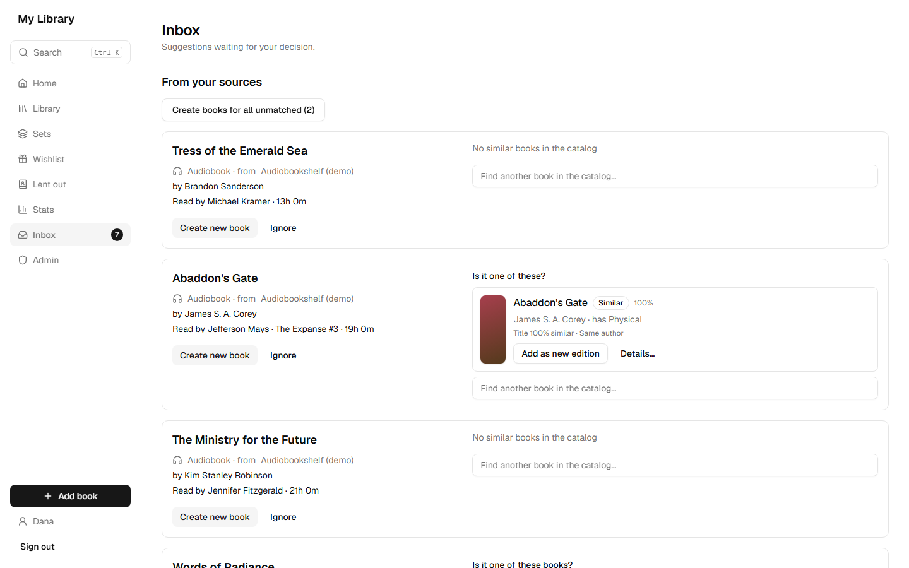 | 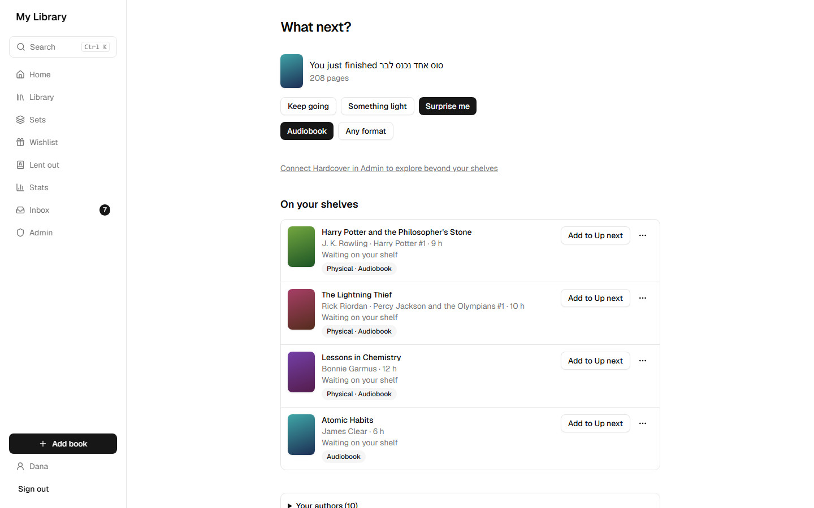 |
| **Inbox.** A synced audiobook, matched to the paper copy you already have. | **What next?** Suggestions from the books waiting on your shelves. |
| 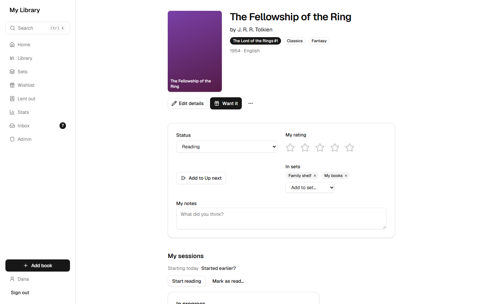 | 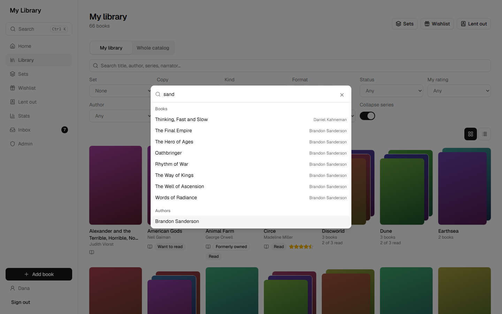 |
| **A book.** Your status, rating, notes, sets and reading sessions. | **Ctrl K.** Jump to any book, author or page. |

<p align="center">
  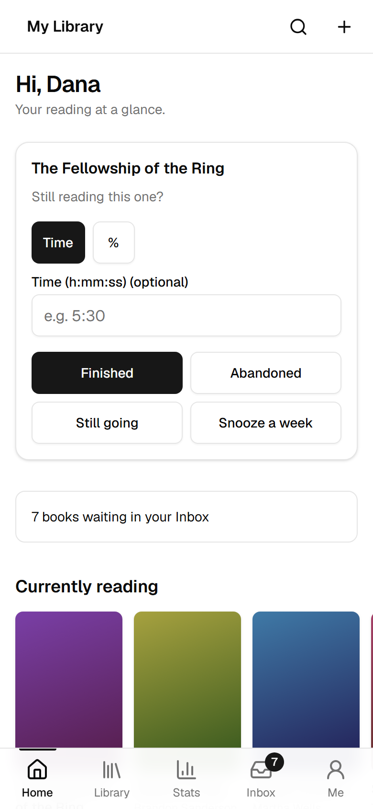
  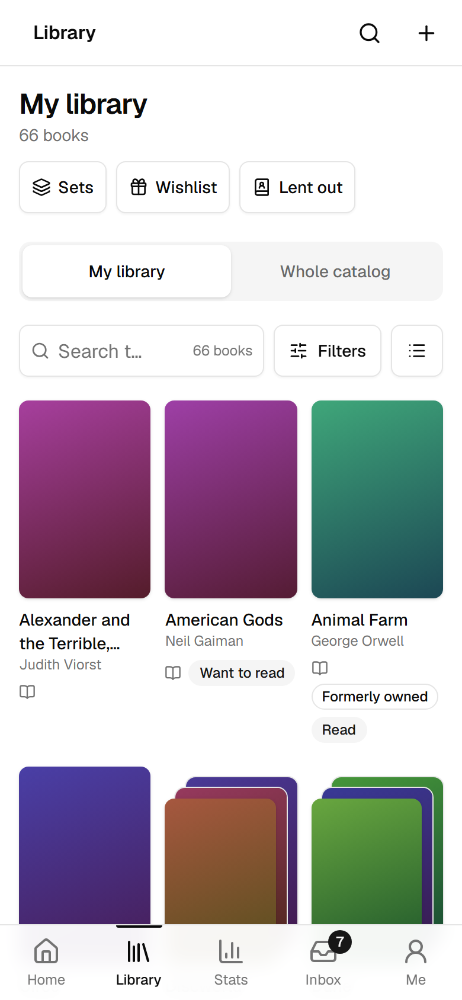
  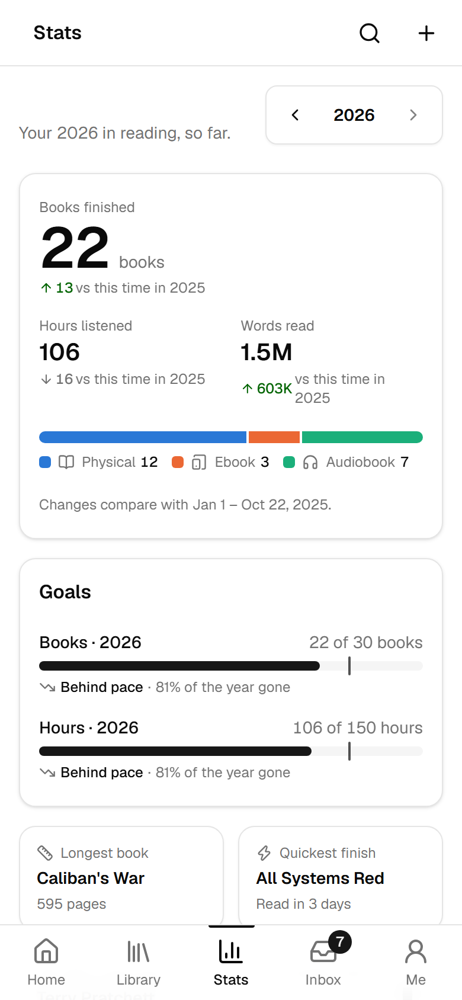
</p>

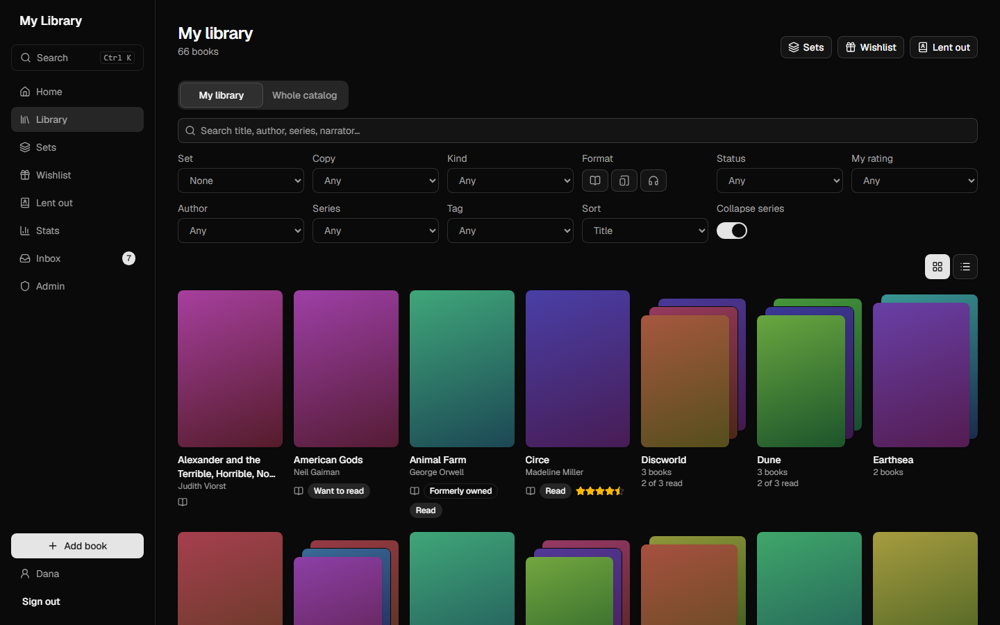

Every screenshot shows the built-in demo household (`pnpm dev:seed-demo`); the covers are the app's own placeholders for books without one. Inside the app, Shelfkeeper still calls itself "My Library", its name from before it was published.

## Try it

You need Docker.

```sh
git clone https://github.com/elazarcoh/shelfkeeper.git && cd shelfkeeper
cp .env.example .env        # set POSTGRES_PASSWORD and APP_SECRET_KEY (the file shows how to generate it)
docker compose up -d --build
```

Open `http://<server>:8080`. The first visit creates the admin account; the admin then adds household members (Admin → New person), optionally with a PIN for quick sign-in.

- Compose runs three services: `db`, `app` (web + API) and `worker` (source syncs and schedules).
- Keep `APP_SECRET_KEY` safe: it encrypts source API tokens. If the key changes, re-enter each source's API token in Admin → Sources.
- **Backups:** Admin → Backups. A verified backup is written every night (03:00 in `TZ` by default), and before every upgrade and every restore.
- Serving over HTTPS behind a reverse proxy? Set `COOKIE_SECURE=true`.

This compose file keeps everything in Docker volumes, which is fine for trying the app. For a long-lived install (your own data and backup folders, disk checks, upgrades, restore, cloud backup, a reverse proxy, a sub-path), follow **[Running on a server](docs/install.md)**.

## Documentation

- **[Running on a server](docs/install.md):** install, upgrade, restore, roll back, cloud backup, and serving under a sub-path.
- **[Features in detail](docs/features.md):** sources and the Inbox, reading progress, adding books from a shelf photo or a barcode, and the wishlist.
- **[Developing](docs/development.md):** the dev setup, sample sources, and the tests behind the data-safety promises.

## Security

Shelfkeeper is built for a home network. It serves plain HTTP unless you put an HTTPS proxy in front (then set `COOKIE_SECURE=true`). Passwords are hashed, saved source logins are encrypted with `APP_SECRET_KEY`, and sign-in attempts are throttled, but it has had no security audit and no two-factor sign-in. Don't expose it to the internet; reach it from outside over a VPN instead.

## Stack

TypeScript end to end, in a pnpm workspace (Node 22+, pnpm 10).

| Layer | What |
|---|---|
| Web (`apps/web`) | React 19, Vite 7, TanStack Router + Query, tRPC client, Tailwind CSS 4, shadcn/ui (Radix), lucide icons, sonner toasts, dnd-kit (drag to reorder), cmdk (command palette), PWA (vite-plugin-pwa), barcode-detector + zxing-wasm (ISBN barcodes where the browser has no reader of its own) |
| API (`apps/server`) | Hono on Node, tRPC 11 with superjson, bundled with tsup |
| Worker (`apps/worker`) | Source syncs and scheduled jobs on pg-boss 12 |
| Domain (`packages/domain`) | Pure Zod 4 schemas and rules |
| Data (`packages/db`) | PostgreSQL 17, Drizzle ORM + drizzle-kit migrations, postgres.js driver (patched, see [Developing](docs/development.md)); backups as zip (yazl/yauzl) |
| Jobs (`packages/jobs`) | pg-boss queues, shared by the API and the worker |
| Connectors (`packages/connectors`) | Audiobookshelf, Calibre, Readarr, Chaptarr clients; Hardcover (GraphQL) client, Open Library work lookup |
| Tests | Vitest, Testcontainers (real Postgres), fast-check, Playwright e2e |
| Tooling | ESLint 9 + typescript-eslint (also enforces import boundaries), TypeScript 5.9 |
| Deploy | One Docker image (app + worker) that names its release from the checked-out git tag, Docker Compose, GitHub Actions (checks on every PR; on a tag the checks plus e2e, side by side, then the `release` branch moves), Komodo on a Raspberry Pi behind nginx (a private runbook); restic (in the image) copies backups to Backblaze B2; a public one-commit-per-release snapshot (`scripts/publish-public.sh`, minus `.publicignore`) |

Layering: `packages/domain` → `packages/db` (all per-user queries go through `UserScope`) → `apps/server` → `apps/web`. Import boundaries are enforced by eslint.

## License

[MIT](LICENSE): free to use, change and share. The software comes as is, without warranty of any kind. Keep your own backups.

Shelfkeeper is not affiliated with Simania, Open Library, the National Library of Israel, Hardcover, Audiobookshelf, Calibre, Readarr or Chaptarr. It reads only what you ask it to from them, with your own keys where they need one, so their terms of use still apply to you.
